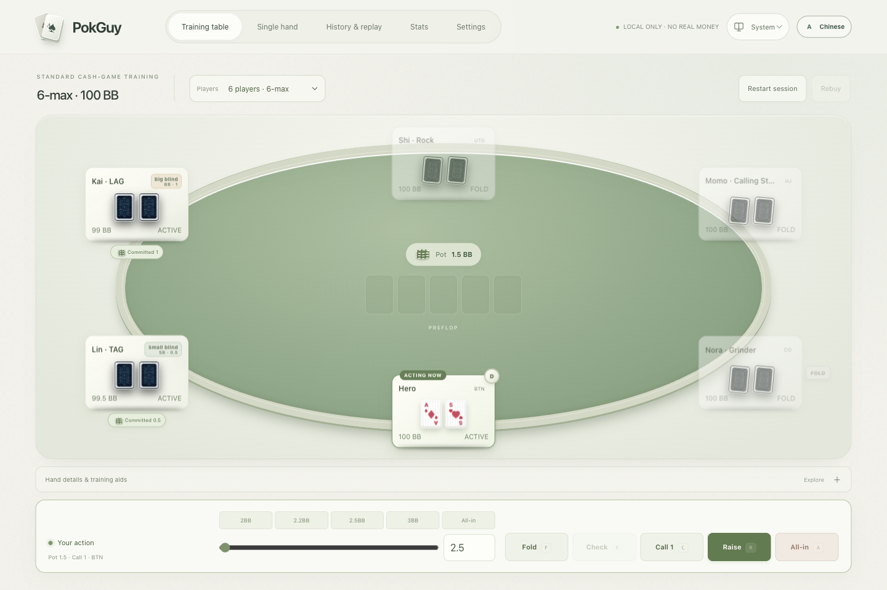

# PokGuy

[English](README.md) · [简体中文](README.zh-CN.md)

**Practice a hand. Review your decisions. Build your poker intuition.**

A local-first Texas Hold’em trainer: play 2–9 seat cash tables against configurable AI, create hand scenarios, and review decisions with history and statistics. No account or real-money play.



## Get started

Use **Node.js 22.13+ (22.x recommended)**.

```bash
git clone https://github.com/ThineLord/PokGuy.git
cd PokGuy
npm ci
npm run dev
```

Open the address printed by the terminal, normally **http://localhost:3000**.

## Practice and review

- **Play and train:** eight editable AI personalities, legal actions, side pots, showdown explanations and custom scenarios.
- **Learn from decisions:** replay hands, add notes, inspect heuristic feedback, and separate cash-table statistics from scenario practice.
- **Keep your data:** full backup with restore preview and save-failure recovery. Records stay in your browser.
- **Make it yours:** English/Chinese, light/dark/system appearance, readable mobile seat details and keyboard controls.

Export a full backup before clearing site data or changing devices. AI feedback is a training heuristic, not a GTO solver.

## Documentation

[User guide](docs/user/README.md) · [Actual workflows](docs/user/0.3.0-walkthrough.md) · [Development](docs/development/README.md) · [All docs](docs/README.md)

**For agents:** [AGENTS.md](AGENTS.md) → [Agent README](docs/agent/README.md).

Source and routes live in `src/`, assets in `public/`, tests and their configuration in `tests/`, build/release helpers in `scripts/`, and guides in `docs/`.

Current version: **0.3.1** · [Release notes](docs/releases/0.3.1.md) · [Changelog](CHANGELOG.md) · [GitHub Releases](https://github.com/ThineLord/PokGuy/releases)

Releases follow [semantic versioning](docs/releases/README.md); browser storage schema versions are independent. This is a learning tool without deposits, withdrawals or real-player matchmaking. A source release does not establish a verified hosted deployment.
