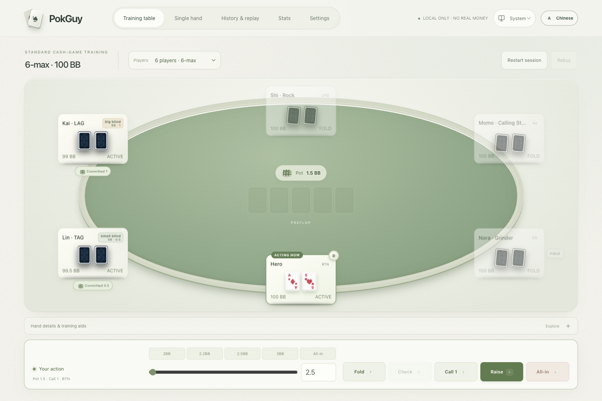

# PokGuy

[English](README.md) · [简体中文](README.zh-CN.md)

**练一手牌，复盘一次决策，建立扑克直觉。**

本地优先的德州扑克训练工具：与可配置 AI 进行 2–9 人现金桌练习，自建单手牌场景，通过历史记录和统计复盘决策。无需账号，不涉及真钱游戏。



## 本地开始

使用 **Node.js 22.13+（推荐 22.x）**。

```bash
git clone https://github.com/ThineLord/PokGuy.git
cd PokGuy
npm ci
npm run dev
```

打开终端显示的地址，通常为 **http://localhost:3000**。

## 练习与复盘

- **对局与训练：** 八种可编辑 AI 风格、合法行动提示、边池、摊牌说明和自定义场景。
- **从决策中学习：** 重放牌局、添加笔记、查看启发式点评，现金桌与场景统计分别累计。
- **保管自己的数据：** 完整备份、恢复预览及保存失败救援；记录保存在当前浏览器。
- **按习惯使用：** 中英文、浅色／深色／跟随系统外观、清晰的移动端座位详情与键盘操作。

清理站点数据或更换设备前，请先导出完整备份。AI 点评是训练启发式规则，不是 GTO 求解器。

## 文档入口

[用户指南](docs/user/README.zh-CN.md) · [实际流程](docs/user/0.3.0-walkthrough.zh-CN.md) · [开发与测试](docs/development/README.md) · [全部文档](docs/README.md)

**Agent 入口：** [AGENTS.md](AGENTS.md) → [Agent README](docs/agent/README.zh-CN.md)。

源码与页面在 `src/`，应用资源在 `public/`，测试及配置在 `tests/`，构建和发布工具在 `scripts/`，说明文档在 `docs/`。

当前版本：**0.3.0** · [更新说明](docs/releases/0.3.0.zh-CN.md) · [更新记录](CHANGELOG.md) · [GitHub Releases](https://github.com/ThineLord/PokGuy/releases)

后续按[语义化版本](docs/releases/README.md)管理；浏览器存储 schema 独立演进。本项目仅用于学习，不提供充值、提现或真人匹配。源码发布不代表已经验证线上部署。
