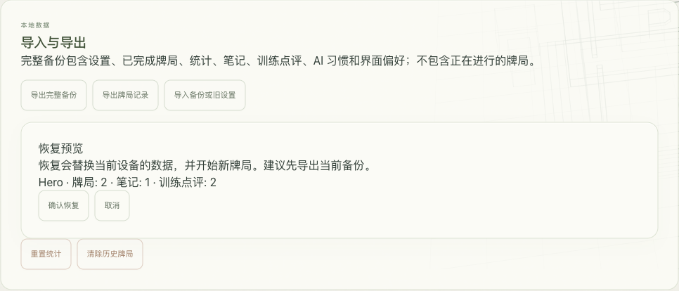
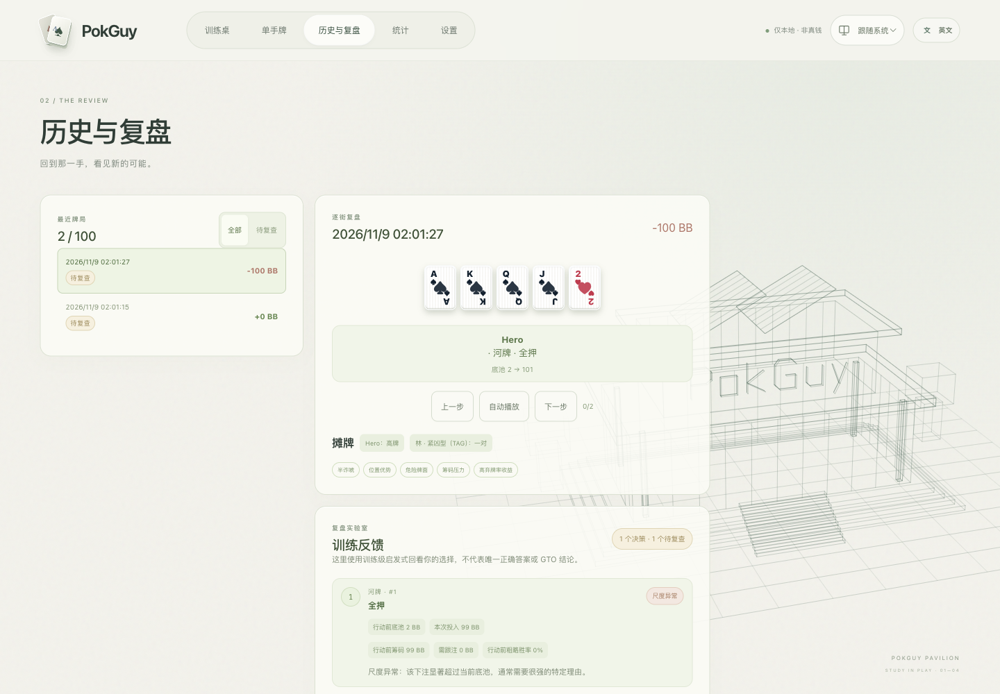
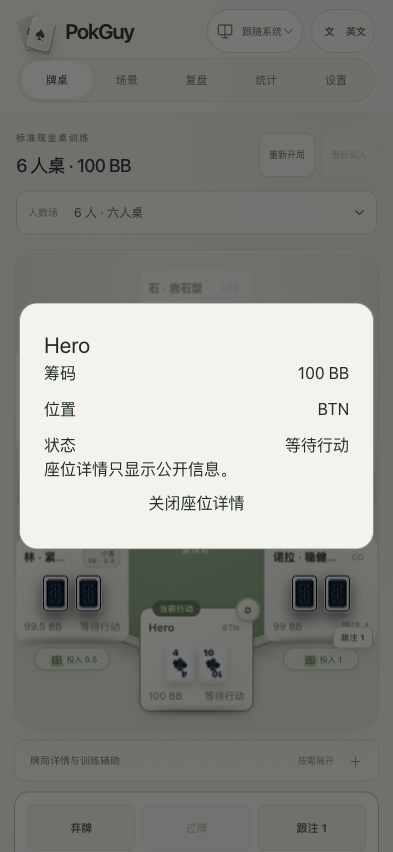

# v0.3.0 walkthrough

[English](0.3.0-walkthrough.md) · [简体中文](0.3.0-walkthrough.zh-CN.md) · [User guide](README.md)

These are screenshots from the running v0.3.0 local app, using newly created demonstration data on 2026-11-09. They are not design mockups.

## Export → preview → restore

We completed one cash hand and one river scenario, added a note, exported a full backup, cleared the demo browser's saved data, and restored through the visible confirmation flow. Before and after: **2 hands, 1 note, 2 reviews; cash 1 and scenario 1**.

A separate quota-error injection kept the changed player name in memory, displayed the unsaved warning and allowed a rescue export. After removing the injected fault, Retry save persisted the changed name. This is a controlled failure test, not a claim that the browser's physical storage was full.

## Review using the information available before acting

An oversized river shove is flagged from its pre-action investment. The warning is independent of the subsequent win/loss. Other uncovered decisions show Not assessed.

## Read a seat on mobile

At 393px, tapping a seat reveals the full name, public stack, position and status. Escape/close returns focus. No hidden opponent cards are included.

Cash/scenario statistics were also switched and checked in this walkthrough. Full automated acceptance and remaining limits are documented in the [acceptance record](../development/ACCEPTANCE_0.3.0.md).
