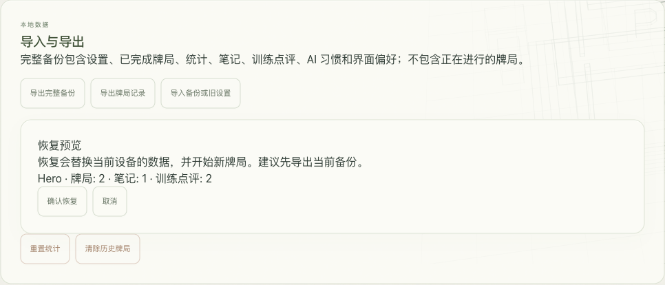
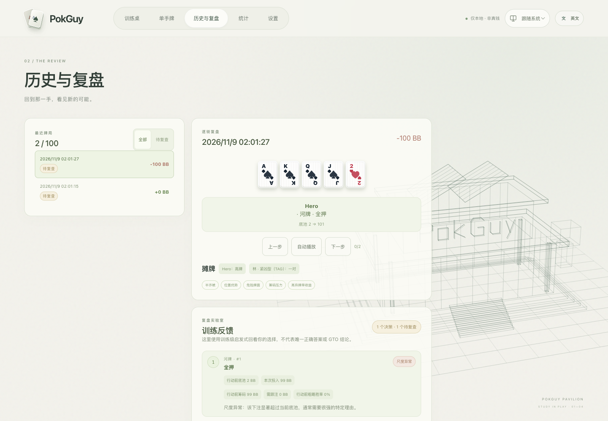
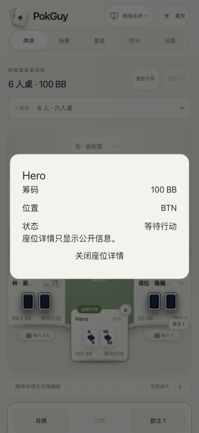

# v0.3.0 实际流程

[English](0.3.0-walkthrough.md) · [简体中文](0.3.0-walkthrough.zh-CN.md) · [用户指南](README.zh-CN.md)

以下为 2026-11-09 在本地运行 v0.3.0、使用新建演示数据的实际截图，不是设计稿。

## 导出 → 预览 → 恢复

实际完成一手现金桌和一手河牌场景，添加笔记，导出完整备份，清空演示浏览器保存的数据，再通过界面确认恢复。恢复前后均为 **2 手牌局、1 条笔记、2 条点评；现金桌 1 手、场景 1 手**。

另一次配额错误注入测试中，修改后的玩家名保留在内存，界面显示未保存警告并允许导出救援备份。移除注入故障后，“重试保存”成功写入新名字。这是受控故障测试，不表示浏览器实际物理空间耗尽。

## 根据行动前信息复盘

过大的河牌全押按行动前投入被标记，提醒不依赖后续输赢。规则无法覆盖的决策显示“未充分评估”。

## 手机端阅读座位

393px 界面点击座位后，显示完整姓名、公开筹码、位置和状态；关闭或 Esc 会返回焦点，不包含对手暗牌。

本次实操也切换检查了现金桌／场景统计。自动化验收和剩余限制见[验收记录](../development/ACCEPTANCE_0.3.0.md)。
